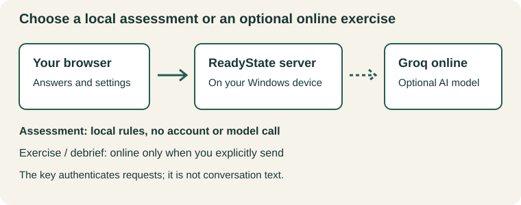

# ReadyState on Windows: first-time setup

For a Windows x64 tester using a complete ReadyState package. No programming,
administrator account, Docker or separate Node installation is needed for that
package. ReadyState opens in your browser while a local server runs in a terminal.
It is a PowerShell-script installer, not a signed EXE/MSI or an automatic updater.
Read this guide on GitHub for formatted steps and the diagram, or open the
included `windows-quick-start.md` in a text editor. The steps work without images.

**Availability:** downloadable releases are not published yet. These package
steps apply when a maintainer supplies an explicitly authorized tester package.
Ask the maintainer for access through the
[repository's issue tracker](https://github.com/tescolopio/ReadyState/issues);
do not attach keys or personal household data. There is no public download link
to offer until a distribution decision is made.
Do not substitute a GitHub source-code ZIP: it does not include the runtime.
Until then, use the
[source installation instructions](https://github.com/tescolopio/ReadyState/blob/main/docs/deployment/local-installation.md#native-node-installation-from-source).

**Feature versions:** the local assessment is on main. Complete encrypted backups
and history are pending #33; the Guided water session is pending #34. Use a build
whose supplied feature list includes them before following those optional steps.
Their presence in this guide does not authorize distributing an unreviewed build.

## 1. Choose what you want to do

| Goal | Groq account/key needed? | Internet needed during use? |
| --- | --- | --- |
| Describe a household, assess it, save actions | No | No model connection needed once ReadyState is installed |
| Use Simple or the Guided water session, if included | No | No model connection needed |
| Run an AI exercise or request its debrief | Yes, if Groq is selected | Yes; Groq runs the model online |



The diagram is schematic, not a screenshot. Assessment is local and rules-based.
Running ReadyState locally does **not** make Groq local. Guidance remains draft;
results are not a safety certification.

## 2. Extract and install the Windows package

1. Obtain the maintainer-supplied **Windows x64** archive, matching source
   revision and SHA-256 checksum. Keep older development previews separate.
2. In File Explorer, right-click the ZIP and choose **Extract All**. Extract to
   an ordinary folder, not inside an existing installation. Keep all files
   together, including `app`, `runtime`, scripts and `release.json`.
3. Open the extracted folder. Right-click inside it and choose **Open in
   Terminal**, or open PowerShell and change to that folder.
4. Verify the downloaded ZIP before running scripts. Replace the example path
   with your actual ZIP location, then compare the entire hash with the supplied
   `SHA256SUMS.txt`. Stop if they differ.

   ```powershell
   Get-FileHash -LiteralPath 'C:\Users\YourUser\Downloads\ReadyState-windows-x64.zip' -Algorithm SHA256
   ```

5. Inspect the supplied scripts. If Windows marks these downloaded files as
   blocked, unblock only the files you have reviewed:

   ```powershell
   Unblock-File .\start.ps1
   Unblock-File .\install.ps1
   Unblock-File .\uninstall.ps1
   .\install.ps1
   ```

   The default installation is `%LOCALAPPDATA%\ReadyState` for the current
   Windows user. It creates a **ReadyState** Start-menu shortcut. It does not
   install a Windows service or a model.

6. Open **ReadyState** from Start. Keep its terminal open. If no browser opens,
   enter **http://localhost:3000/assessment** manually. A working page, not just
   an open terminal, confirms startup.

**Portable alternative:** run `.\start.ps1` in the extracted folder instead of
installing it. Keep that folder intact. Do not start portable and installed
copies simultaneously on the same port.

If execution is blocked by PowerShell or your organization's policy, stop and
ask the maintainer/administrator. Unblocking a file does not override execution
policy. Do not disable security controls or run as administrator to get past it.

## 3. Try the assessment without a key

Leave provider keys unset for this walkthrough:

1. Open **Assessment**. Start with a fictional household or a short profile.
   Leave some details unanswered; uncertainty must not become a deficiency.
2. In **Simple**, enter known facts, then choose **See assessment**. Expand
   **Based on your answers** to see why a finding appeared.
3. If Guided is included, choose **Guided assessment**. Confirm People, then
   Pets, then Water. Each stage offers **Save and exit**; later stages offer Back.
4. Try **Help me count**. Counts remain a draft until you confirm and choose
   **Use counted amount**. Leaving the helper must not record a false zero.
5. Read Findings, continue to Next steps and save one useful action. Finish.
   A reviewed topic does not mean the household is prepared.
6. Return through Simple, change an answer and inspect the updated finding.
   A previously saved action remains a historical choice, not a live deficiency.
7. Close the server with **Ctrl+C**, launch again, and use the same browser,
   profile and URL. Check that your household and plan remain.

Do **not** press **Send this** or request a debrief during this key-free check.
No provider setup is necessary to complete the assessment. This walkthrough
checks the interface; it does not establish AI accuracy or independent human
usability.

## 4. Optional: create a Groq account and API key

You can skip this entire section unless you want AI exercises.

1. Open [Groq Console](https://console.groq.com) and follow its current
   sign-up/sign-in prompts. Create or select your organization/project as
   prompted. Account screens may change.
2. Check your available plan and
   [account limits](https://console.groq.com/settings/limits). Groq offers
   quota-limited free access; this guide does not promise unlimited use, a
   particular model allowance or a fixed number of exercises.
   Do not enable paid billing or upgrade unless you intentionally want charges.
3. Open [API Keys](https://console.groq.com/keys) and use its key-creation control.
   Choose a recognizable label such as `ReadyState local`. Groq says only team
   owners or users with the developer role can manage keys; contact your
   organization owner if the control is unavailable.
4. Copy the secret directly into ReadyState Settings in the next section.
   Treat it like a password. Do not paste it into chat, screenshots, a household
   note, an exercise, an issue or source code. Use a password manager if you need
   a separate copy; do not assume the console can reveal it again later.
5. Review [Groq's data policy](https://console.groq.com/docs/your-data) and your
   [Data Controls](https://console.groq.com/settings/data-controls) before
   sending household context. Local hosting and masking do not guarantee
   anonymity or eliminate provider processing.

Groq's current policy says usage metadata is retained, and inputs/outputs may
be retained for reliability or abuse investigations unless applicable controls
are enabled. Read the current policy rather than assuming "free" means private
or that nothing is retained.

## 5. Configure ReadyState through Settings

You do not need to edit an environment file for ordinary browser configuration.

1. Exit Guided if active, then open **Settings**.
2. In **Model Provider**, select **Groq** in **Provider**.
3. Leave **Model** empty to use the displayed default. At writing, ReadyState's
   default is `openai/gpt-oss-120b`; model availability can change. Do not pick an
   arbitrary replacement simply because it is free: exercise/tool reliability
   is not established for every listed model.
4. Paste the secret into **API key**. Choose **Save** and check for
   **Saved to this browser.**
5. Reload Settings and check that the provider remains Groq and the key field
   is populated (masked). This checks local saving, **not key validity**.
   Saving settings does not make a model request.

When an exercise is explicitly sent, your browser sends the key to ReadyState's
local server, which uses it to authenticate with Groq. The key is **not** part
of the model's conversation text. The reviewed conversation itself is sent
online. Debrief sends the existing exercise history, including model-generated
events, for another model call.

Browser-saved settings and working household/history data are not an encrypted
vault. Someone with access to your browser profile may read them. Switching
providers clears the draft key; save the new settings deliberately.
**Use server defaults** removes the browser override, but does not revoke a
key or remove a key configured on the server.

If included in your build, **Settings -> Full encrypted backups** can save the
browser-stored key together with local records in a password-encrypted backup.
Keep its password separately: there is no password recovery. Ordinary working
browser data remains unencrypted. Household-only exports do not include keys.

## 6. Only when you choose: run a small live exercise

This section explains the boundary; this guide's preparation did not run a
model, create an account or incur charges.

Choose a fictional household for the first live trial. Select a scenario, inspect
the outgoing preview, edit/mask sensitive details and cancel if unsure.
**Send this** authorizes a model request. Each further response and debrief can
use additional quota. Settings/review/cancellation alone do not verify a key.

Free limits can interrupt an exercise, particularly as its history grows.
Check your account's actual request and token limits; do not assume that one
successful turn proves a full exercise will fit. Do not repeatedly retry an
exhausted quota or upgrade automatically. Model responses and debrief quality
remain limitations distinct from installation success.

## 7. Common problems

| What you see | What to do |
| --- | --- |
| No page or browser did not open | Keep the terminal open, inspect its error and try `http://localhost:3000/assessment`. If startup failed, report the error with secrets removed. |
| Port 3000 is occupied | Stop the ReadyState copy you started using Ctrl+C. Do not kill unrelated processes. Changing ports creates a different browser-storage origin; the launcher does not silently change ports. |
| Installation folder or shortcut already exists | Stop the old installation and follow Updates below. The installer intentionally refuses to overwrite it. |
| Provider authentication failure / 401 | Check that you selected Groq and copied its key without surrounding spaces. Replace/revoke an invalid key in Groq. A saved key is not necessarily a valid key. |
| Rate limit / 429 | Wait for the stated reset/retry time and check Groq account limits. Daily-token exhaustion may require a longer wait; rapid retries do not fix it. |
| Model unavailable or permission denied | Check account model access and the configured model ID. Ask the maintainer which alternative is supported; do not assume every Groq model works with ReadyState. |
| Network error | Assessment still needs no model. AI exercises need an internet connection and access from the local server to Groq. Check local firewall/network policy without exposing ReadyState to your LAN. |
| Answers seem missing after restart | Use the same browser profile and exact origin. `localhost` and `127.0.0.1`, different ports, private browsing and different profiles have separate storage. Do not clear browser data as a first troubleshooting step. |
| Local save or backup fails | Check browser storage permissions/space. Preserve existing data; do not assume a failed save succeeded. Encrypted backups require HTTPS or localhost plus supported Web Crypto; an insecure LAN HTTP address is insufficient. |
| A key was exposed | Revoke it in Groq immediately, create a replacement and update ReadyState. Old browser copies/backups may still contain the revoked key. Never share the exposed secret while reporting the issue. |

## 8. Updates and removal

Before updating, record the source revision in `release.json` and export a backup.
If full encrypted backup is available, use it to preserve browser settings/keys,
records and household data. Otherwise use the available household/plan export;
it is not a complete backup of settings/history.

1. Stop ReadyState with Ctrl+C.
2. In the **old installation** folder, run `.\uninstall.ps1` to remove its owned
   shortcut only. Preserve separately created configuration files.
3. Move that old installation aside using File Explorer. Extract/verify the
   new authorized archive, then run its installer. Do not mix old/new `app` or
   `runtime` directories.
4. Launch and reopen/hard-refresh tabs. Use the same browser profile and
   `http://localhost:3000` to retain browser data. Check Assessment and Settings.
   Older builds may not understand newer stored fields; reverting application
   files is not a guaranteed data rollback.

For removal, stop the server first. Run `.\uninstall.ps1` for shortcut-only
removal, or `.\uninstall.ps1 -RemoveInstallation` for the known package files.
Unrelated files and browser data are not removed. Inspect remaining files
before deleting any folder. Revoking a Groq key is a separate action in Groq.
There is no automatic update service.

## Sources and illustration record

Provider information checked **2026-11-02**:
[API Keys](https://console.groq.com/keys),
[rate limits](https://console.groq.com/docs/rate-limits),
[data policy](https://console.groq.com/docs/your-data).
Use your console for account-specific values; availability and policies change.

`windows-data-flow.svg` is an original repository-authored schematic, licensed
AGPL-3.0-only with the repository. It contains no third-party artwork, provider
screenshots, keys or personal household information. Its purpose is to explain
the local/online boundary, not to certify privacy or safety. All steps remain
usable as text without the illustration.
